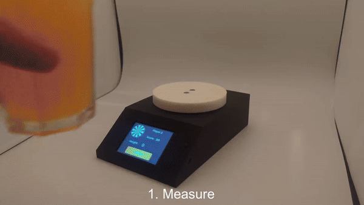
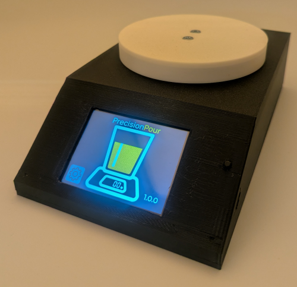
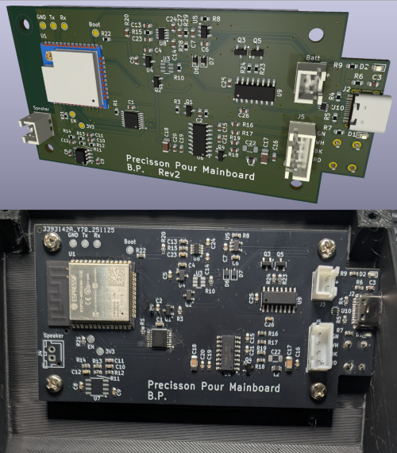
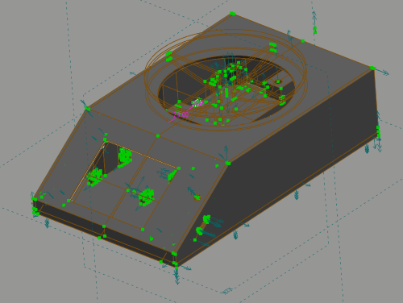
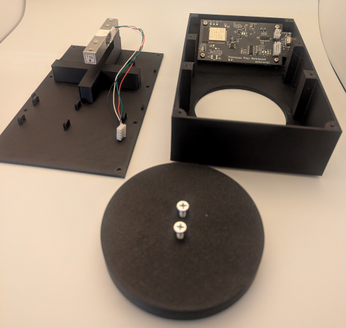

# Precision Pour


A game for people who have trouble to stay hydrated. Grab a glass of water or some juice and get your liquid in a playful way.  
The first version used a regular kitchen scale with made-up rules. This motivated creating this portable, ready-to-play game.

It consists of load cells available in several weight grades, a 3D-printed enclosure and a custom PCB with touchscreen and LiPo charger.




## Features

- **Weight Capacity**: Depending on used load cell (recommended 2kg)
- **Accuracy**: About 0.2g
- **Display**: 320x240 TFT with touch screen
- **Battery Life**: ~4 hours of gameplay (with 1000mAh LiPo)
- **Charging**: USB-C
- **Multiplayer**: Up to 10 players
- **Game Modes**: Target & Darts





## Gameplay

Be sure the battery is charged (using the USB-C connector).
First press anywhere on the splash screen to enter the game mode selection screen. There you can set the number of players.

### Target

In the target mode, you set the number of rounds to play and an amount of liquid to drink in ml (it's assumed that 1ml is 1g).
After this the first player has to place the drink on the platform and press "Weight". This measures the tare weight. So it is possible to change the drink during the game.
Then the player has to drink the amount that the screen says in the section "Target", place it on the platform again and press "Drink and weight".
After this, the difference of the first and second measurement is used and subtracted from the target value. Everything below 1g of tolerance is added as malus points.
Then it is the next player's turn. After the selected number of rounds, a screen shows the malus points of all players sorted from winner to loser.

### Darts

This is a game mode where the players have to drink down from 301ml.
The gameplay is the same as in target mode, with the difference that the maximum value is 60ml (as triple 20 in darts). If the value is below 60 or higher as the remaining score of the player, it is a failure "throw" and does not count.
The first who manages to reduce his score to zero wins.

## Hardware

### Electronics



The PCB is designed so it can be ordered directly from JLCPCB. It is based on a 2432S028 ESP32 development board with TFT which was used before creating the custom PCB adding the battery charger and load cell amplifier.

You will also need:
- A load cell with a 1 or 2kg range: https://de.aliexpress.com/item/1005006892146384.html
- A TFT display with touch: https://de.aliexpress.com/item/1005008045337422.html
- A LiPo battery. The game draws about 220mA, so a 1000mAh battery would last about 4h of gameplay.
- Some JST XH connectors (1x2 and 1x4) to connect the battery and the load cell
- A 6x6mm push button

Crimp the battery connector contacts and pin them as the silk screen shows.
Crimp the load cell as the silk screen shows.
Solder the push button on the back side of the PCB.
Solder the display to the back side of the PCB. This is a bit tricky since the flat ribbon connector takes some experience to solder. After that, use some double sided tape to fix the display to the PCB.

### Housing & CAD



Print the STL files from the housing folder. Depending on your printer, maybe the upper shell needs some support on the display hole. 

Print 
1x lower_shell.stl
1x upper_shell_mainboard.stl
1x scaleplate.stl
1x top_protection_ring.stl (optional)

### Assembly



For assembly you will need:
- 2x M4x20 countersunk screws
- 2x M5x20 screws
- 6x M3x12 countersunk screws
- 4x M3x8 screws
- Some zip ties

The types of the screws do not really matter, use what you have in stock.

Screw the load cell to the lower shell using the M5 screws. You can use the little pods on the base plate to strap the cables down with zip ties.
Strap down the battery using the pods with zip ties. 
Insert the PCB and use the M3 screws to mount it.
Connect the battery and the load cell with the PCB and close the housing. Use the countersunk M3 screws to close the housing.
Now you can use glue to glue the protection ring around the big top opening. This shall prevent fluid to flow into the device.
Put the scaleplate.stl on top and use the M4 countersunk screw to mount it. 


## Development

### Tools & Technologies

- **3D Design**: [Solvespace](https://solvespace.com/)
- **Electronics**: [KiCad](https://www.kicad.org/)
- **Firmware**: [PlatformIO](https://platformio.org/)
- **UI**: [SquareLine Studio](https://squareline.io)

### Build & Upload

Connect the device with a PC using the USB-C connector. Turn it on by long-pressing (>1s) the button. After this, a new COM port should be detected. 
Build and upload and the display should turn on.

Use PlatformIO CLI in the `Firmware/` folder:

```bash
# Build
pio run
# Upload (auto-detects COM port)
pio run -t upload
# Optional: specify environment and COM port
pio run -e <env> -t upload --upload-port COM5
```

### Calibration

For the first time, a setup has to be done by pressing the gear-button on the splash screen.
There remove everything from the upper plate and press the tare button. Then add a known weight and set its weight in grams using the buttons on the screen, then press set. After this, the game is calibrated.

### Project Structure

```
Firmware/       - ESP32 firmware source code
Housing/        - 3D models and CAD files
Schematic/      - PCB design and schematics
assets/         - Images and media files
```

---

## To-Do

- [ ] Fixing the audio output

---
